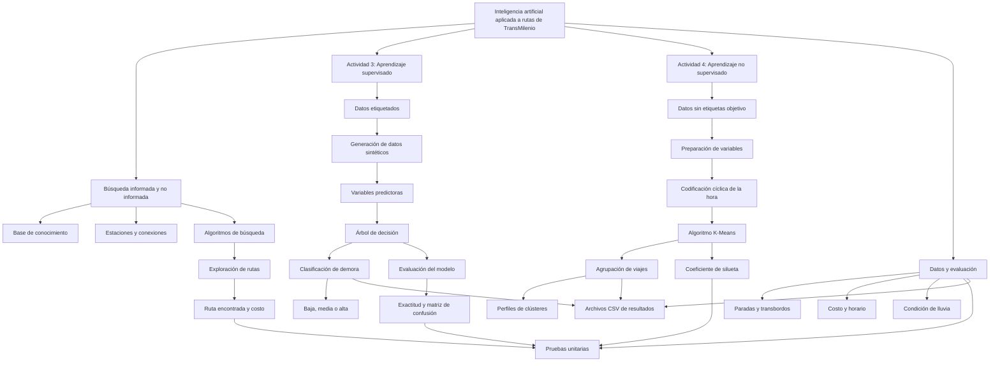

# Mapa conceptual: Inteligencia artificial aplicada a rutas de TransMilenio

## Interpretación

El proyecto integra tres enfoques. La búsqueda de rutas permite encontrar recorridos entre estaciones conectadas. El aprendizaje supervisado utiliza datos sintéticos etiquetados para clasificar el nivel simulado de demora mediante un árbol de decisión. El aprendizaje no supervisado aplica K-Means para descubrir grupos de viajes con características similares.

La evaluación se apoya en pruebas unitarias, métricas de clasificación y el coeficiente de silueta. Los resultados se almacenan en archivos CSV para su consulta.

**Alcance:** los resultados de aprendizaje automático se basan en datos sintéticos y no representan predicciones validadas sobre la operación real de TransMilenio.
